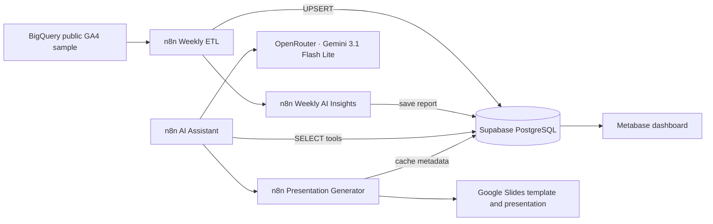

# GA4 AI Analytics Automation

A portfolio and learning project that turns the public Google Analytics 4 (GA4) sample ecommerce events into weekly PostgreSQL metrics, a Metabase dashboard, grounded AI analysis, saved weekly insights, and on-demand Google Slides presentations.

> **Data note:** This project uses anonymized historical sample data from 2020-11-01 through 2021-01-31. Weekly loading simulates refreshes; it is not live GA4 traffic.

## Current implementation

The n8n instance currently contains four GA4 workflows. The workflow exports in this repository are credential-free and have instance-specific Google Drive and subworkflow references replaced with placeholders.

| Workflow | Observed state | Purpose |
|---|---|---|
| `GA4 Weekly ETL` | Inactive; schedule trigger is deactivated | Reads the next historical week from Supabase, aggregates BigQuery KPIs, upserts the week, then invokes Weekly AI Insights. |
| `GA4 - Weekly AI Insights` | Inactive; credential-free export included | Compares the latest consecutive complete weeks, skips an unchanged metrics snapshot, generates a bounded English report, and upserts `weekly_insights`. |
| `GA4 - AI Analytics Assistant` | Published and active | Chat interface using OpenRouter `google/gemini-3.1-flash-lite`, Simple Memory, read-only PostgreSQL tools, and a presentation tool workflow. |
| `GA4 - Presentation Generator` | Published and active; PowerPoint export node deactivated | Reuses a cached deck for the same insight version or copies a Slides template, fills placeholders, stores the presentation reference, and returns its link. |

A Metabase dashboard named **GA4 E-commerce Analytics** is open in the local browser at `http://localhost:3001`. The dashboard has not been independently audited for every chart/query in this documentation pass.

## Architecture

## Repository map

- `workflows/exports/`: Sanitized, structurally valid n8n workflow JSON exports.
- `workflows/docs/`: Per-workflow node order, purpose, and configuration notes.
- `sql/`: PostgreSQL schema and reusable SQL.
- `prompts/`: AI system prompt and manual test prompts.
- `docker/`: Local Metabase Compose example.
- `docs/`: Setup, security, QA checklist, costs, roadmap, and architecture details.
- `.env.example`: Names only; never put real secrets in this repository.

## Quick start

1. Review [setup guide](docs/SETUP.md), [database schema](sql/schema.sql), and [security notes](docs/SECURITY.md).
2. Create the required tables in Supabase and configure n8n credentials locally.
3. Import workflow exports from `workflows/exports/` using **n8n → Workflows → Import from File**.
4. Rebind credentials and replace placeholder IDs for Google Drive, Slides, and called workflows.
5. Run the workflows manually against a disposable/test period and inspect their execution results before enabling any schedule.
6. Start Metabase with the example Compose file and connect it using a dedicated read-only PostgreSQL role.

Detailed steps and environment values are in the linked guides. This repository does not contain credentials or live data.

## KPI contract

- `total_events`: event row count.
- `total_users`: distinct `user_pseudo_id` in that reporting week.
- `purchases`: purchase event count.
- `purchase_users`: distinct users with a purchase event.
- `revenue_usd`: purchase event revenue in USD, summed from the sample export.
- `conversion_rate_pct`: `100 * purchase_users / NULLIF(total_users, 0)`.

Users are distinct within each week and must not be summed across weeks to represent period-unique users. Weekly intervals are consecutive Sunday–Saturday blocks starting November 1, 2020; the final interval is a single day (2021-01-31) and is excluded from full-week comparisons.

## Status and known gaps

See [project status](docs/STATUS.md) for verified vs planned work. Historical on-demand report generation is not claimed as implemented. Weekly AI insights and presentation generation are separate downstream flows; both the ETL and Weekly AI Insights workflows are inactive, so do not assume automatic report generation is running.

## License

No license is included yet. Choose one before making this repository public.
