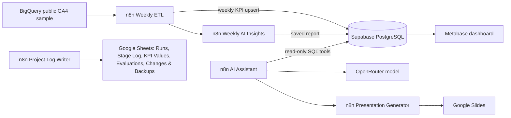

Warning: truncated output (original token count: 1404)
Total output lines: 77

# GA4 AI Analytics Automation

A learning and portfolio project built around the public Google Analytics 4 (GA4) ecommerce sample. It aggregates weekly metrics in BigQuery, stores them in Supabase PostgreSQL, displays them in Metabase, and uses n8n for SQL-grounded analysis and Google Slides reporting.

> **Data note:** The dataset is anonymized historical sample data from 2020-11-01 through 2021-01-31. Weekly loading simulates refreshes; it is not live GA4 traffic.

## System at a glance

## Current documented components

| Component | Evidence-based description |
|---|---|
| Weekly ETL | Repository export is inactive; schedule is deactivated. It gets the next historical block, queries BigQuery, upserts `weekly_kpis`, then calls Weekly AI Insights. |
| Weekly AI Insights | Repository export compares the latest consecutive complete weeks, skips an unchanged metrics snapshot, generates a bounded report, and upserts `weekly_insights`. A later captured snapshot has explicit return and logging branches. |
| AI Analytics Assistant | Observed published and active on 2026-10-25. The Nov 7 clean chat round passed 10/10 documented cases. |
| Presentation Generator | Observed published and active on 2026-10-25. A Nov 7 chat case returned a cached Slides link; template-generation and recovery paths were not covered by that round. |
| Project Log Writer | The live log workbook has five verified tabs: `Runs`, `Stage Log`, `KPI Values`, `Evaluations`, and `Changes & Backups`.…404 tokens truncated…`: count of purchase event rows.
- `purchase_users`: distinct weekly users with a purchase event.
- `revenue_usd`: purchase revenue from the anonymized sample.
- `conversion_rate_pct`: `100 * purchase_users / NULLIF(total_users, 0)`.

Reporting blocks are consecutive Sunday–Saturday intervals starting on 2020-11-01. The final date, 2021-01-31, is a one-day partial block and is excluded from complete-week comparisons. Weekly distinct-user counts must not be summed and presented as period-unique users.

## Quick start

1. Read [setup](docs/SETUP.md), [example schema](sql/schema.sql), [security notes](docs/SECURITY.md), and [project status](docs/STATUS.md).
2. Inspect the target database before applying example DDL. Configure credentials only in local n8n credential storage.
3. Import one sanitized export at a time into a disposable or test instance, then reconnect credentials and instance-specific workflow references.
4. Keep schedules off until manual tests and database writes have been reviewed. Do not assume a repository export has the same nodes as the currently published workflow.
5. Configure a least-privilege read-only PostgreSQL role for Metabase and the assistant.

The workflow exports contain no API secrets or credential values. They are reference starting points, not turnkey deployments.

## Offline evidence and deliverables

- [Assistant chat test evidence](output/ga4-assistant-chat-test-evidence-2026-11-07.md): 10 of 10 reviewed cases passed in a clean second round.
- [GA4 Slides template v1](output/GA4_Weekly_Executive_Report_Template.pptx), [v2](output/GA4_Weekly_Executive_Report_Template_v2.pptx), and [v3](output/GA4_Weekly_Executive_Report_Template_v3.pptx): offline presentation template revisions.
- [Metabase dashboard notes](docs/METABASE_DASHBOARD.md): local dashboard metadata and known evidence gaps; no screenshot or portable dashboard export is checked in.

## License

No license is included yet. Choose one before making the repository public.
