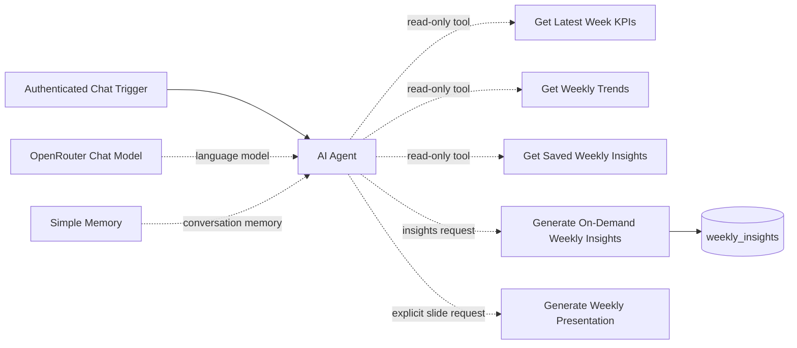

# GA4 AI Analytics Assistant

**Observed state:** published and active in n8n on 2026-11-04. Chat Trigger requires n8n user authentication. The model is OpenRouter `google/gemini-3.1-flash-lite`, temperature 0.1, max tokens 1024. Simple Memory is connected. The sanitized export has no credential references.

## Node order and purpose

1. **When chat message received** — authenticated chat UI and welcome text.
2. **OpenRouter Chat Model** — language model provider.
3. **AI Agent** — selects tools based on the request and is instructed to ground answers in results.
4. **Get Latest Week KPIs** — read-only query for latest complete-week KPIs and conversion rate.
5. **Get Weekly Trends** — up to 20 complete weeks with SQL-computed CVR and revenue WoW changes; excludes partial periods.
6. **Simple Memory** — conversational context buffer.
7. **Get Saved Weekly Insights** — reads saved insight reports.
8. **Generate On-Demand Weekly Insights** — generates or reuses an insight for an eligible complete reporting week.
9. **Generate Weekly Presentation** — tool-workflow call to the presentation generator. The assistant uses it only for an explicit slide request.

An insights-only request does not call the presentation tool. A cache hit returns the saved report without running the insights-generation LLM or save node. If the user explicitly asks for both a report and slides, the presentation tool is selected because that slide request is explicit.

SQL and exact system message: [assistant system prompt](../../prompts/ai-assistant-system-prompt.md). Test prompts: [manual checks](../../prompts/assistant-test-prompts.md). Export: [ga4-ai-analytics-assistant.json](../exports/ga4-ai-analytics-assistant.json).

## Workflow diagram

## Failure handling

- If a tool reports `not_found`, explain that no matching complete-week comparison or saved report exists; do not invent a report.
- If a tool fails, acknowledge the failure. Invalid-date and presentation fault-injection cases are summarized in [project status](../../docs/STATUS.md).
- Use only presentation links returned by the presentation workflow; Drive sharing permissions still apply.
