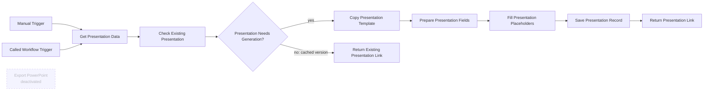

# GA4 Presentation Generator

**Observed state:** published and active. Includes a manual test trigger and an execute-workflow trigger. PowerPoint export/download node is deactivated.

## Node order and purpose

- **When clicking ‘Execute workflow’** — manual invocation for testing.
- **Get Presentation Data** — loads the latest complete-week saved insight, metrics snapshot, model, and generation timestamp.
- **Copy Presentation Template** — duplicates a Drive presentation template; template file identifier must be rebound after import.
- **Prepare Presentation Fields** — transforms saved metrics and report content into placeholder fields. The exact JavaScript is retained inside the sanitized export.
- **Fill Presentation Placeholders** — makes the Slides API update request to replace text placeholders.
- **Export PowerPoint** — optional download node; deactivated in the source.
- **Return Presentation Link** — returns the new deck link from manual runs.
- **When Executed by Another Workflow** — called by the AI Assistant tool.
- **Check Existing Presentation** — checks cache by `week_start` and report `generated_at` version.
- **Presentation Needs Generation?** — branches based on cache lookup.
- **Return Existing Presentation Link** — avoids creating a duplicate if the report version is cached.
- **Save Presentation Record** — upserts the generated presentation reference and source-report timestamp.

The export replaces Drive/presentation identifiers and credential bindings. Reconnect the template, OAuth credential, and assistant tool workflow after import. See [sanitized JSON](../exports/ga4-presentation-generator.json).

## Workflow diagram

