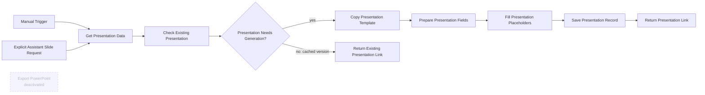

# GA4 Presentation Generator

**Observed state:** published and active on 2026-11-04. Includes a manual test trigger and an execute-workflow trigger. PowerPoint export/download node is deactivated.

## Node order and purpose

- **When clicking ‘Execute workflow’** — manual invocation for testing.
- **Get Presentation Data** — loads the saved insight, metrics snapshot, model, and generation timestamp used for the deck.
- **Copy Presentation Template** — duplicates a Drive presentation template; template file identifier must be rebound after import.
- **Prepare Presentation Fields** — transforms saved metrics and report content into placeholder fields. It requires the copied presentation result to contain an `id`.
- **Fill Presentation Placeholders** — makes the Slides API update request to replace text placeholders. A provider error stops the later save step.
- **Export PowerPoint** — optional download node; deactivated in the source.
- **Return Presentation Link** — returns the new deck link from manual runs.
- **When Executed by Another Workflow** — called by the AI Assistant for an explicit slide request.
- **Check Existing Presentation** — checks the cache by `week_start` and report `generated_at` version.
- **Presentation Needs Generation?** — branches based on cache lookup.
- **Return Existing Presentation Link** — returns the existing deck for a cached version without copying, filling, or saving another record.
- **Save Presentation Record** — upserts the generated presentation reference and source-report timestamp after the Slides update succeeds.

The Assistant does not invoke this workflow for an insights-only request. It invokes it only when the user explicitly asks for slides. A cache hit returns the existing link without creating another Drive file.

The export replaces Drive/presentation identifiers and credential bindings. Reconnect the template, OAuth credential, and assistant tool workflow after import. See [sanitized JSON](../exports/ga4-presentation-generator.json).

## Verified cache and error paths

- Execution `1111` reused a deck created earlier by `1108`; the cache path skipped template copy, placeholder fill, and presentation-record save.
- Fault-injection execution `1113` had no copied-presentation `id` and stopped with `Copied presentation ID is missing` before Slides/Save.
- Fault-injection execution `1114` supplied a fake Slides ID and received provider 404, `The resource you are requesting could not be found`; Save did not run. Neither pinned fault-injection run made a Drive copy.

These paths are summarized in [project status](../../docs/STATUS.md). The error checks are fault injection, not evidence of a production provider outage.

## Workflow diagram

