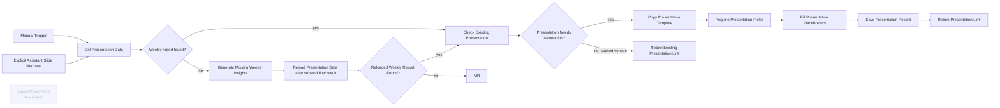

# GA4 Presentation Generator

**Observed state:** published and active on 2026-11-04. Includes a manual test trigger and an execute-workflow trigger. PowerPoint export/download node is deactivated.

## Node order and purpose

- **When clicking ‘Execute workflow’** — manual invocation for testing.
- **When Executed by Another Workflow** — called by the AI Assistant for an explicit slide request.
- **Get Presentation Data** — defaults to the latest complete KPI week, or uses the requested week. Loads its saved insight and metrics when available.
- **Generate Missing Weekly Insights** — if the requested week's saved insight is missing, requests an insight for that same week.
- **Reload Presentation Data** — reloads the exact requested week after Weekly Insights returns a generated or cached report.
- **Reloaded Weekly Report Found?** — IF node; sends a found report to the presentation cache path, otherwise to **Return Missing Report**.
- **Return Missing Report** — returns `not_found` when the requested week's insight cannot be produced; no slides are created.
- **Check Existing Presentation** — checks the cache by `week_start` and report `generated_at` version.
- **Presentation Needs Generation?** — branches based on cache lookup.
- **Return Existing Presentation Link** — returns the existing deck for a cached version without copying, filling, or saving another record.
- **Copy Presentation Template** — duplicates a Drive presentation template; template file identifier must be rebound after import.
- **Prepare Presentation Fields** — transforms saved metrics and report content into placeholder fields. It requires the copied presentation result to contain an `id`.
- **Fill Presentation Placeholders** — makes the Slides API update request to replace text placeholders. A provider error stops the later save step.
- **Save Presentation Record** — upserts the generated presentation reference and source-report timestamp after the Slides update succeeds.
- **Return Presentation Link** — returns the new deck link after a successful Slides update, including called-workflow runs.
- **Export PowerPoint** — optional download node; deactivated in the source.

A missing report follows this order: call **Generate Missing Weekly Insights** for the same week, reload that exact week's saved report, then check the presentation cache and either reuse or create the deck. If Weekly Insights cannot find a valid comparison, **Return Missing Report** returns `not_found`. The Assistant invokes this workflow only for an explicit slide request; an insights-only request does not create a deck.

The export replaces Drive/presentation identifiers and credential bindings. Reconnect the template, OAuth credential, and assistant tool workflow after import. See [sanitized JSON](../exports/ga4-presentation-generator.json).

## Verified cache and error paths

- Execution `1111` reused a deck created earlier by `1108`; the cache path skipped template copy, placeholder fill, and presentation-record save.
- Fault-injection execution `1113` had no copied-presentation `id` and stopped with `Copied presentation ID is missing` before Slides/Save.
- Fault-injection execution `1114` supplied a fake Slides ID and received provider 404, `The resource you are requesting could not be found`; Save did not run. Neither pinned fault-injection run made a Drive copy.

These paths are summarized in [project status](../../docs/STATUS.md). The error checks are fault injection, not evidence of a production provider outage.

## Workflow diagram

