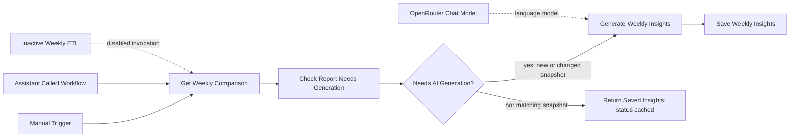

# GA4 Weekly AI Insights

## Purpose and current state

This workflow compares a selected complete Sunday-to-Saturday week in `public.weekly_kpis` with its immediately preceding complete week, asks an OpenRouter model for a concise, evidence-bounded executive analysis, and upserts the result into `public.weekly_insights`. It was published and active in n8n on 2026-11-04. The Weekly ETL remains inactive; the Assistant's on-demand tool is the active request path.

The workflow accepts an explicit `requested_week`; if omitted, it uses the latest eligible complete-week pair. A selected week requires a consecutive complete predecessor. If no valid pair exists, the workflow returns `not_found`.

The credential-free export is [`../exports/ga4-weekly-ai-insights.json`](../exports/ga4-weekly-ai-insights.json). It removes instance-specific workflow/node IDs and credential bindings. Reconnect credentials after import.

## Trigger and processing

1. **Manual trigger** — execute the workflow for a controlled test.
2. **Called-workflow trigger** — used by the AI Assistant's on-demand insights tool. The inactive ETL also has an invocation node, but its schedule is disabled.
3. **Get Weekly Comparison** — selects the requested complete week, or the latest eligible pair by default. It excludes partial periods, requires the prior week to end the day before the selected week begins, and computes WoW changes for users, purchases, revenue, and revenue per purchase, plus conversion-rate change in percentage points.
4. **Check Report Needs Generation** — looks for a saved row with the selected `week_start` and an identical JSONB `metrics_snapshot`. The `requested_week` input is excluded from snapshot equality. This checker determines whether a generation decision is needed; it does not itself emit the final `status=cached`.
5. **Needs AI Generation?** — IF node branches on the cache check. A matching snapshot goes to **Return Saved Insights**; a new or changed snapshot goes to **Generate Weekly Insights**.
6. **Generate Weekly Insights** — asks for an English report under 300 words with Executive Summary, KPI Performance, Key Findings, and Recommended Investigations. It is bounded to SQL results and historical/anonymized-data context, without unsupported causal claims.
7. **OpenRouter Chat Model** — observed model `google/gemini-3.1-flash-lite`, temperature 0.2, max output 1000 tokens.
8. **Save Weekly Insights** — parameterized Postgres upsert keyed by `week_start`; stores report markdown, metrics snapshot, model name, and generation timestamp.
9. **Return Saved Insights** — returns the existing saved row for a cache hit with `status=cached`, without running the insights-generation LLM or save node.

The current comparison output carries `prompt_version=weekly-insights-v1`. Existing execution `1115` generated and saved the `2020-11-22` report; `1116` returned it through the saved-insights branch at `generated_at=2026-11-04T20:44:33.798Z`. See [status evidence](../../docs/STATUS.md).

## Query and persistence details

The exact SQL and parameter expressions are preserved in the export. The comparison query uses only `weekly_kpis`; it does not query raw GA4 events or establish business causality. `revenue_per_purchase_usd` is descriptive and is not asserted to be a validated average order value.

The cache check compares the selected `week_start` and JSONB `metrics_snapshot`; the request input itself does not affect snapshot equality. The current prompt version is `weekly-insights-v1`. Review the live workflow before changing the versioning scheme or assuming a prompt edit invalidates a cached row.

## Conditional presentation flow

This workflow does not call the presentation generator. The Assistant routes an insights-only request here and calls the presentation workflow only when the user explicitly requests slides. A cache hit here therefore does not create a deck.

## Limitations and safe operation

- A report requires a selected complete week and its immediately preceding consecutive complete week. Requesting `2020-10-25` returned `not_found` because no eligible comparison was available.
- A malformed `requested_week` such as `not-a-date` currently fails at the date comparison with a database parsing error; it does not reach the LLM or save node.
- This workflow uses aggregated weekly KPIs, not raw GA4 events, and does not establish causality.
- The sanitized export has no credentials. Select least-privilege PostgreSQL and OpenRouter credentials after import; never commit credential exports or tokens.
- Validate SQL, schema, connection permissions, and model output in a disposable environment before activation.

## Workflow diagram

